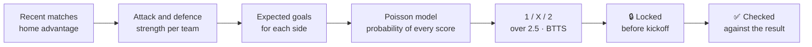

<div align="center">

<a href="https://jeremstyke.github.io/ai-football-predictor/?src=github"></a>

# AI Football Predictor

### The probability of every football match, checked against real results.

Win, draw and loss probabilities · expected goals · most likely score · live in-play odds

<br>

[](https://jeremstyke.github.io/ai-football-predictor/?src=github)
[](https://t.me/ai_football_predictorbot/app?startapp=src_github)
[](https://t.me/aifootballpredictorchannel)

[](https://jeremstyke.github.io/ai-football-predictor/?src=github)
[](#-competitions)
[](#-a-track-record-you-can-check)
[](README.fr.md)
[](README.fr.md)

<br>

<a href="https://jeremstyke.github.io/ai-football-predictor/blog/?src=github"></a>

</div>

<br>

## ✨ What it is

**AI Football Predictor** is a free app that gives the **home win, draw and away win probability** (1 / X / 2) of every football match in more than 25 competitions. Each probability is **locked before kickoff** and compared with the real result, and the full history, hits and misses, stays public.

<table>
<tr>
<td width="33%" valign="top">

### 🎯 Probabilities
1 / X / 2 for every match, every day, with the **most likely matches of the day** highlighted.

</td>
<td width="33%" valign="top">

### ⚽ Goals
**Expected goals (xG)**, the **most likely score** and the full score grid, **over 2.5** and **both teams to score**.

</td>
<td width="33%" valign="top">

### 🔴 Live
Score, minute, scorers and the **probability moving in real time** during the match.

</td>
</tr>
<tr>
<td width="33%" valign="top">

### 🔔 Follow a match
Alerts 15 minutes before, at kickoff, on every goal, at half time and full time.

</td>
<td width="33%" valign="top">

### 🏆 Season tables
**Predicted final tables** from nightly simulations: title, top 4 and relegation chances.

</td>
<td width="33%" valign="top">

### 🤖 Beat the model
A Telegram game where you try to do better than the AI, alone or against your friends.

</td>
</tr>
</table>

<br>

## 📱 Use it anywhere

| | Where | |
|:-:|---|---|
| 🌐 | **Website and web app**, installable on iPhone and Android | [Open](https://jeremstyke.github.io/ai-football-predictor/?src=github) |
| ✈️ | **Telegram mini app**, with match alerts from the bot | [Open](https://t.me/ai_football_predictorbot/app?startapp=src_github) |
| 📣 | **Telegram channel**, the most likely matches every day | [Join](https://t.me/aifootballpredictorchannel) |
| 📰 | **Blog**, AI-written previews of the big matches | [Read](https://jeremstyke.github.io/ai-football-predictor/blog/?src=github) |

<br>

## 🧠 How the probabilities are made



1. **Team strength.** Each team gets an attack and a defence rating from its recent matches, with recent games weighted more and home advantage included.
2. **Expected goals.** Those ratings give the expected goals of both teams for this match.
3. **Poisson model.** Expected goals become the probability of every score (0-0, 1-0, 1-1, 2-1...). Adding the scores up gives win, draw and loss, over 2.5 and both teams to score.
4. **Lock and check.** The probability is frozen before kickoff, then compared with what really happened.

Full details in the **[method page](https://jeremstyke.github.io/ai-football-predictor/method/?src=github)**.

> [!NOTE]
> These are **probabilities, not certainties**. Something at 60% fails 4 times out of 10, and that is expected. A model is judged over hundreds of matches, which is why the history is public.

<br>

## 📊 A track record you can check

Many prediction sites only show their wins. Here:

- ✅ every probability is published **before** the match and can no longer change;
- ✅ every result is added automatically after the final whistle;
- ✅ the whole history, good and bad, is **public** in the app's **Reliability** tab.

**[→ See the live track record](https://jeremstyke.github.io/ai-football-predictor/?src=github)**

<br>

## 🏟 Competitions

<table>
<tr><td>🇪🇺 <b>Champions League</b></td><td>🏴 <b>Premier League</b> · FA Cup · EFL Cup</td></tr>
<tr><td>🇪🇸 <b>LaLiga</b> · Copa del Rey</td><td>🇮🇹 <b>Serie A</b></td></tr>
<tr><td>🇩🇪 <b>Bundesliga</b> · DFB-Pokal</td><td>🇫🇷 <b>Ligue 1</b></td></tr>
<tr><td>🇵🇹 <b>Liga Portugal</b> · Taça de Portugal</td><td>🇳🇱 <b>Eredivisie</b></td></tr>
<tr><td>🏴 <b>Scottish Premiership</b> · Scottish Cup · League Cup</td><td>🇧🇪 Pro League · 🇹🇷 Süper Lig · 🇬🇷 Super League</td></tr>
<tr><td colspan="2">🌍 Brazil · Argentina · Saudi Arabia · Norway · Romania · Croatia · Serbia · Ukraine · Bulgaria · Cyprus</td></tr>
</table>

<br>

## 🧩 Free widget for your website

Show live probabilities on your site or blog, **free** and updated automatically.

```html
<div class="afp-widget" data-lang="en" data-lg="E0,CL" data-n="6">
  <a href="https://jeremstyke.github.io/ai-football-predictor/">Football probabilities by AI Football Predictor</a>
</div>
<script src="https://jeremstyke.github.io/ai-football-predictor/embed.js" async></script>
```

| `data-type` | Shows |
|---|---|
| *(empty)* | Today's matches with probabilities |
| `live` | Live matches and in-play probability |
| `match` | One match (`data-match="<id>"`) |
| `team` | One team, form and next matches |
| `table` | A predicted season table |
| `articles` | The latest match previews |

**[→ All widgets and the code generator](https://jeremstyke.github.io/ai-football-predictor/widget/?src=github)**

<br>

## 📰 Match previews

For the big matches, our AI writes a **preview from our own data only**: probabilities, expected goals, recent form, standings and head to head. Each preview is updated with the result after the match.

[Read the previews](https://jeremstyke.github.io/ai-football-predictor/blog/?src=github) · [Previews widget](https://jeremstyke.github.io/ai-football-predictor/widget/articles/?src=github) · [RSS feed](https://jeremstyke.github.io/ai-football-predictor/feed.xml)

<br>

## 🔌 Football probabilities API

For media, apps and developers.

| Endpoint | Returns |
|---|---|
| `GET /matches` | Upcoming matches: 1 / X / 2, xG, most likely score, over 2.5 |
| `GET /live` | Live matches with in-play probability |
| `GET /tables` | Predicted end-of-season tables |
| `GET /teams/{id}` | Form, next matches, season projection |
| `GET /reliability` | The public track record |
| `GET /articles` | Ready-to-publish previews in English and French, with image |

**[→ Docs and early access](https://jeremstyke.github.io/ai-football-predictor/api/?src=github)**

<br>

## ❓ FAQ

<details>
<summary><b>Is AI Football Predictor free?</b></summary>
<br>
Yes. The website, the web app, the Telegram mini app and the widget are free.
</details>

<details>
<summary><b>Is this betting advice?</b></summary>
<br>
No. These are statistical estimates for information only, with no guaranteed result. 18+ only. If gambling is a problem for you, get help from a support line in your country.
</details>

<details>
<summary><b>Where does the data come from?</b></summary>
<br>
Fixtures, results and line-ups come from a sports data provider. The probabilities, expected goals, simulated tables and previews are produced by our own model.
</details>

<details>
<summary><b>How do I install it on my phone?</b></summary>
<br>
Open the website in Safari (iPhone) or Chrome (Android) and choose "Add to Home Screen". Or open the mini app straight from Telegram.
</details>

<details>
<summary><b>Why doesn't the most likely result always happen?</b></summary>
<br>
A 55% chance means the other outcomes happen 45% of the time. One match proves nothing either way; the public history over many matches is what shows whether the probabilities are right.
</details>

<br>

---

<div align="center">

**AI Football Predictor** · made by [@jeremstyke](https://t.me/jeremstyke) · [🇫🇷 Version française](README.fr.md)

<sub>football predictions · soccer predictions · AI football predictions · match probabilities · win draw loss probability · expected goals · xG · Poisson model · 1X2 · over 2.5 goals · BTTS · Premier League predictions · Champions League predictions · LaLiga predictions · Serie A predictions · Bundesliga predictions · Ligue 1 predictions · football widget · football API</sub>

</div>
